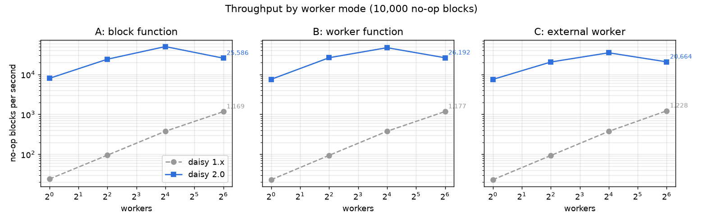
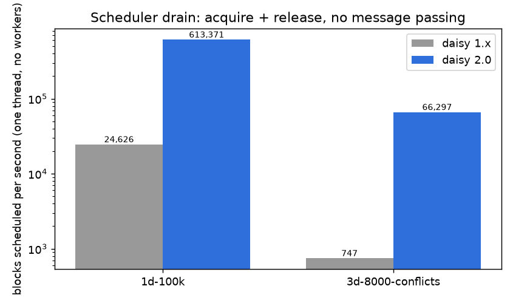
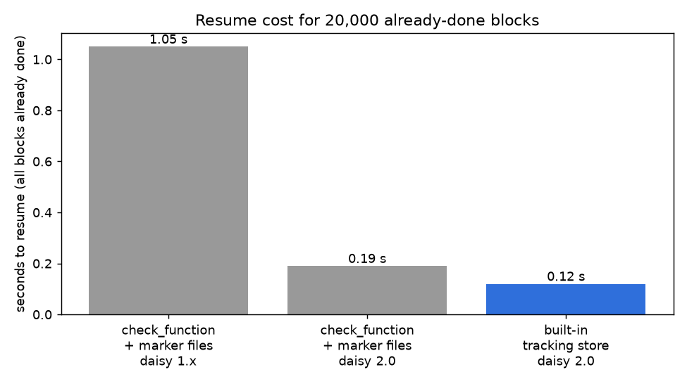

# Migration guide: daisy 1.x → daisy v2

daisy v2 is a Rust rewrite. The Python surface is mostly compatible with daisy 1.x; this document describes the deltas that matter to existing users.

## tl;dr

- **Existing 1.x code should keep working.** `pip install -U daisy` upgrades you to v2 and the top-level `import daisy` namespace is the **v1.x backwards-compatibility surface** (`daisy.v1_compat`). Code that uses `Task(num_workers=…)`, `daisy.SerialServer`, etc. continues to run; you'll just see `DeprecationWarning`s pointing at the v2 names.
- **For new code, prefer the v2 interface.** Use `import daisy.v2 as daisy` to get the cleaner v2 API with no compat aliases (and no deprecation warnings).
- **It is a lot faster.** 17 to 330 times the block throughput of 1.x at every worker count, a scheduler that drains 100,000 blocks in a sixth of a second, and resumes that read one byte per block. See [Speed](#speed).
- **Some 1.x APIs are gone.** Array I/O (`daisy.persistence`, `daisy.Array`, `daisy.open_ds`, `daisy.prepare_ds`) is no longer re-exported. See [Removed APIs](#removed-apis) below. `funlib.geometry` ROIs and Coordinates keep working everywhere.

## Importing the v2 interface

Three import options:

| Import                            | Surface                                                       |
| --------------------------------- | ------------------------------------------------------------- |
| `import daisy`                    | v1.x compat (default — same as `daisy.v1_compat`)             |
| `import daisy.v1_compat as daisy` | v1.x compat (explicit)                                        |
| `import daisy.v2 as daisy`        | v2 native — Rust types exposed directly, no compat aliases    |

The v2 surface drops `Task(num_workers=…)`, `SerialServer`, and a handful of other 1.x-only names. In return you get cleaner kwargs (`max_workers`), no deprecation warnings, and `Roi`/`Coordinate`/`Block`/etc. resolved to the underlying Rust classes (`daisy._daisy.*`) without an extra Python wrapper layer.

If you're starting a fresh project, **use `import daisy.v2 as daisy`**. If you're maintaining a daisy 1.x codebase and want gradual migration, leave bare `import daisy` and address the deprecation warnings file by file.

## API mapping (1.x → v2)

| 1.x                                      | v2                                                            |
| ---------------------------------------- | ------------------------------------------------------------- |
| `Task(num_workers=N)`                    | `Task(max_workers=N)`                                         |
| `daisy.SerialServer().run_blockwise(t)`  | `daisy.run_blockwise(t, multiprocessing=False)`               |
| `daisy.Server().run_blockwise(t)`        | unchanged (or `daisy.run_blockwise(t)`)                       |
| `daisy.run_blockwise(t)` returning bool  | unchanged signature; bool semantics tightened (see below)     |
| `from funlib.geometry import Roi, Coord` | unchanged. `daisy.Roi` and `daisy.Coordinate` are funlib's classes on every surface, every entry point accepts them, and every ROI daisy hands back (blocks, `Task.total_roi`) is one. The Rust core keeps its own geometry types private. |
| `daisy.persistence`, `Array`, etc.       | gone — use `funlib.persistence` directly                      |

### `run_blockwise` return value

In daisy 1.x, `run_blockwise` returned `True` whenever the scheduler finished accounting for every block — including blocks that permanently failed. The 1.x docstring claimed "all blocks successfully run" but the implementation was actually "all blocks reached a terminal verdict." daisy v2 tightens this: **`run_blockwise` returns `True` only if every block of every task completed successfully (or was skipped because a previous run already marked it done)**. Permanently failed or orphaned blocks now make the bool return `False`.

If you have 1.x scripts that branched on `if run_blockwise(...):` to detect "did the run finish accounting" rather than "did everything succeed," you'll want to switch to inspecting the `TaskState` counters returned from `Server.run_blockwise(...)` directly.

## New in v2

A few things v2 added that have no 1.x equivalent:

- **Block tracking as a built-in** (`Task(tracking_path=…)` or via `set_tracking_basedir(…)`; `done_marker_path` / `set_done_marker_basedir` are deprecated aliases). A per-task Zarr v3 group recording which blocks completed (used to skip already-done work on resume) and how many times each failed. `Task.reset()` clears it for an explicit re-run. Tracking is **opt-in**: without an explicit path or a basedir set, nothing is tracked or skipped. The recommended pattern is one `set_tracking_basedir("<stable absolute path>")` call at pipeline start. Note that tracking is keyed by task_id + block geometry, *not* by your code — rerunning changed code against existing tracking resumes silently, so use distinct task_ids per pipeline version or `Task.reset()` after code changes. It is also bound to the exact task layout: changing any ROI (including growing `total_roi` for a dataset that acquired more data) invalidates it entirely; in-place migration for grown volumes is a planned enhancement (see `docs/source/design/DONE_MARKERS.md`).
- **Per-block resource tracking** (`Task(resource_tracking=True)`, needs a tracking path). Each block reports its wall time, CPU time, peak RSS and IO bytes, measured inside whoever ran it — so thread, subprocess and external cluster workers all report the same numbers. Values land in the tracking group as sibling arrays indexed the same way as `done`, readable with plain `zarr.open_group(...)`, and the run prints an agglomerated **Resource Utilization** summary. daisy measures the whole block body automatically; `with daisy.profile_block(block):` narrows the scope if you want to exclude your own setup. Programmatic access: `daisy.Server().last_tracking_summary`. 1.x had no equivalent.
- **`block_tracking` flag on `run_blockwise`** to disable done-marker tracking entirely for a run.
- **`JsonProgressObserver`** — line-delimited JSON progress events, useful for piping into log aggregators or external dashboards.
- **Per-task resource budgets** (`requires` per task + global `resources` dict) — coordinate worker concurrency across tasks competing for shared resources (CPU, GPU, etc.).
- **Worker restart cap** with proper abandonment + transitive downstream orphan propagation.
- **Run statistics** (per-worker, per-task, process-wide) surfaced after each run.

## How workers run

> **Behavior change: blocks always time out.** `Task(timeout=...)` now
> defaults to **600 seconds (10 minutes)** and cannot be disabled —
> `timeout=None` means the default, and non-positive values raise
> `ValueError`. In 1.x the parameter existed but was never enforced (a
> wedged block hung the run forever). In v2 a block that exceeds its
> deadline is reclaimed and retried, its worker process is killed, and
> when a task fails on timeouts both the run summary and the abandonment
> error say so and point at `Task(timeout=...)`. Raise the value
> explicitly for genuinely slow blocks.

### One worker model: a dedicated process each

On the distributed run paths **every worker is its own OS process**, as in
daisy 1.x. Whatever your `process_function` is, daisy serializes it (with
`cloudpickle` when installed, which gives 1.x's lambda/closure support back)
and each worker slot runs `python -m daisy._subprocess_worker`:

| your function | what the worker process does |
| --- | --- |
| `f(block)` — 1 arg | runs the standard `Client.acquire_block()` loop and calls `f` per block |
| `f()` or `f(*, context)` — 0 args | calls `f` once; `f` drives its own loop, and may `srun`/`sbatch` a further process |

Consequences worth knowing:

- **CPU-bound python scales with `max_workers`.** There is no shared GIL.
- **`Task(timeout=…)` truly preempts.** A stuck block's process is killed.
- **`max_workers=N` means N python interpreters**, each importing your
  function's modules. Budget memory accordingly.
- **Your function must be picklable.** Objects that cannot cross a process
  boundary (threading locks/conditions, open write handles, live database
  connections — held directly or by an object your function is bound to) are
  rejected before the run starts, with guidance. Create them inside the
  function instead, or pass a path and reopen it in the worker.
- **No free shared memory.** Workers cannot share a large read-only array by
  closing over it; `numpy.memmap` a file instead, which costs one page cache
  copy rather than one heap copy per worker.

Serial execution (`run_blockwise(…, multiprocessing=False)`) is the in-process
escape hatch: single-threaded, no workers, your original function called
directly. Use it for `pdb`, for closures over live objects, and in tests that
need to observe in-process state.

A 0-arg worker function runs in its own process with `DAISY_CONTEXT` already
in that process's environment, so whatever it launches (`srun`, `sbatch`,
`subprocess.run`) inherits the context and a `daisy.Client()` in the
grandchild connects without you forwarding anything, exactly as in 1.x. The
only launchers that need help are ones that drop the environment on purpose:
`sbatch --export=NONE`, `docker run` without `-e DAISY_CONTEXT`, `ssh`. Pass
the variable through there (`--export=ALL` or `-e DAISY_CONTEXT`), or declare
`def start_worker(*, context)` to receive the parsed `daisy.Context` and hand
`context.to_env()` to the launcher yourself. The context carries the master's
log directory, and constructing a `daisy.Client()` adopts it, as in 1.x. The old `set_log_basedir(client.context["logdir"])` line is now
redundant — harmless, but you can delete it. A worker that wants its logs
somewhere else calls `set_log_basedir(...)` *after* constructing its client.

## Verified behaviour differences

Every row below links to a script under [`experiments/`](experiments/README.md)
that runs unchanged with daisy 1.x or 2.0 installed and prints what it
measured, next to daisy's own report. Each experiment directory also has a
README with the captured output on both lines, so you can read the result
without running it. A [representative 3-D task in every worker mode](experiments/representative/README.md)
shows the normal case first; the speed plots are in the [Speed](#speed)
section below and in [`experiments/speed/`](experiments/speed/README.md).

### Same behaviour on both lines

| Case | 1.x | 2.0 | Verify |
| --- | --- | --- | --- |
| Happy path: 512 3-D blocks with context, modes A, B, C and S | every block exactly once | every block exactly once | [representative/modes.py](experiments/representative/README.md) |
| `funlib.geometry` `Roi`/`Coordinate` passed to `Task`, `Block`, used inside process functions | works; `daisy.Roi` is funlib's | works; `daisy.Roi` is funlib's | [funlib_geometry_types](experiments/same_behavior/funlib_geometry_types/README.md) |
| A 0-arg worker function launches a subprocess that calls `daisy.Client()` | the grandchild finds `DAISY_CONTEXT` in its environment | the same, nothing to forward | [log_basedir_none](experiments/different_by_design/log_basedir_none/README.md) |
| `check_function` returns `numpy.bool_(True)` | every block skipped | every block skipped | [check_function_numpy_bool](experiments/same_behavior/check_function_numpy_bool/README.md) |
| `check_function` raises | block runs; exception logged per block | block runs; exception logged once per task | [check_function_raises](experiments/same_behavior/check_function_raises/README.md) |
| A worker is SIGKILLed while holding a block | replaced, block retried | replaced, block retried | [worker_sigkill](experiments/same_behavior/worker_sigkill/README.md) |
| Serial mode with a 0-argument worker function | TypeError at the first block | configuration error before the run | [serial_worker_function](experiments/same_behavior/serial_worker_function/README.md) |

### 1.x waits forever, 2.0 finishes or refuses

| Case | 1.x | 2.0 | Verify |
| --- | --- | --- | --- |
| A block never returns, `Task(timeout=5)` | the timeout is never enforced; the run hangs | worker killed at 5 s, block retried, reported failed after `max_retries` | [hung_block_timeout](experiments/v1_hangs_v2_finishes/hung_block_timeout/README.md) |
| The spawn function exits immediately | respawned 10 times a second, forever | `max_workers + max_worker_restarts` starts, then `RuntimeError` | [crashing_spawn_function](experiments/v1_hangs_v2_finishes/crashing_spawn_function/README.md) |
| Fire-and-forget launcher whose worker later dies | nothing is respawned; the run hangs | `RuntimeError` explaining that spawn functions must block | [fire_and_forget_launcher](experiments/v1_hangs_v2_finishes/fire_and_forget_launcher/README.md) |
| Log directory containing `:` with external workers | every worker fails to parse `DAISY_CONTEXT`; respawn storm | values are percent-encoded; the run completes | [log_dir_with_colon](experiments/v1_hangs_v2_finishes/log_dir_with_colon/README.md) |
| `num_workers=0` / `max_workers=0` | waits forever | `ValueError` when the task is built | [zero_workers](experiments/v1_hangs_v2_finishes/zero_workers/README.md) |
| Downstream task reaching beyond its upstream's write region | reachable blocks finish, then the run hangs | the pipeline is refused before it starts | [unreachable_downstream](experiments/v1_hangs_v2_finishes/unreachable_downstream/README.md) |

### 1.x finishes with failed blocks, 2.0 abandons the task

On 2.0 an exception in a block function kills its worker, and every worker
death counts against `Task(max_worker_restarts=10)`. A run with more
persistently failing blocks than that budget is abandoned, its remaining
blocks are orphaned and `run_blockwise` raises. Raise the budget, or catch
exceptions inside the block function, for data with many bad blocks.

| Case | 1.x | 2.0 | Verify |
| --- | --- | --- | --- |
| 20 always-failing blocks of 2,000, 4 workers | finishes the other 1,980, returns `True` | abandoned after 14 worker deaths; the rest orphaned; `RuntimeError` | [twenty_bad_blocks](experiments/v1_finishes_v2_abandons/twenty_bad_blocks/README.md) |
| External worker that fails every block | a new job every 4 failures; returns `True` | one job per failure until the budget is spent; `RuntimeError` | [always_failing_remote_worker](experiments/v1_finishes_v2_abandons/always_failing_remote_worker/README.md) |
| A failure after the other worker was released as idle, `max_worker_restarts=0` | retried by the failing worker | abandoned with one orphan | [late_failure_after_idle_release](experiments/v1_finishes_v2_abandons/late_failure_after_idle_release/README.md) |

### 1.x is silent, 2.0 is loud

| Case | 1.x | 2.0 | Verify |
| --- | --- | --- | --- |
| Every block failed | `run_blockwise` returns `True` | returns `False` | [return_value_with_failures](experiments/v1_silent_v2_loud/return_value_with_failures/README.md) |
| The block raises an exception that cannot be pickled | failure list empty, returns `True` | traceback carried as text, returns `False` | [unpicklable_exception](experiments/v1_silent_v2_loud/unpicklable_exception/README.md) |
| Two tasks with the same `task_id` | the second is dropped silently | `ValueError` | [duplicate_task_ids](experiments/v1_silent_v2_loud/duplicate_task_ids/README.md) |
| Ctrl-C mid-run | returns `False`; in-flight blocks missing from the summary | prints what finished, raises `KeyboardInterrupt` | [ctrl_c](experiments/v1_silent_v2_loud/ctrl_c/README.md) |
| `check_function` returns an array | the whole run aborts with `ValueError` | warns once, treats the block as not done | [check_function_array](experiments/v1_silent_v2_loud/check_function_array/README.md) |

### Different by design

| Case | 1.x | 2.0 | Verify |
| --- | --- | --- | --- |
| No `timeout` passed and a block runs 11 minutes | completes | killed at the 600 s default, retried, reported failed; pass `Task(timeout=...)` for long blocks | [default_timeout](experiments/different_by_design/default_timeout/README.md) |
| Every block already done on a re-run | empty execution summary | summary with a `skipped` column | [all_blocks_already_done](experiments/different_by_design/all_blocks_already_done/README.md) |
| `set_log_basedir(None)` seen by an external worker | `logdir=None`, the string; a worker that redirects its output writes to `./None/<task>/worker_<n>.out` | `logdir=`, empty; `Client()` maps it back to `None` and nothing is written | [log_basedir_none](experiments/different_by_design/log_basedir_none/README.md) |
| Progress output when stderr is a file | two refreshes per block | a handful of refreshes per second | [progress_output_volume](experiments/different_by_design/progress_output_volume/README.md) |
| Resuming 20,000 done blocks | one `check_function` call per block on the scheduling thread | the same, or one byte per block with the built-in tracking store | [resume_check_function_vs_tracking](experiments/different_by_design/resume_check_function_vs_tracking/README.md) |

## Speed

Three measurements from [`experiments/speed/`](experiments/speed/README.md),
each from a script that runs on either line. The figures are from daisy
1.2.3 and 2.0.0 on one 96-core machine; the scripts, the raw CSV rows and
the plotting script are next to the README there.

### Block throughput by worker mode and worker count

10,000 no-op blocks, 1-D, no conflicts. 1.x is bounded at about 23 blocks
per second per worker: a 43 ms round trip per block, because its tornado
sockets leave Nagle on and run into the 40 ms delayed-ACK timer. 2.0 sets
`TCP_NODELAY` and is bounded by its scheduler thread instead, so it peaks
around 16 workers for a run this short. The three worker modes cost the
same on each line; the mode only changes who starts the worker process.



| Mode | Workers | 1.x blocks/s | 2.0 blocks/s | Ratio |
| --- | --- | --- | --- | --- |
| A, block function | 1 | 24 | 7,999 | 333 |
| A | 16 | 377 | 49,897 | 132 |
| A | 64 | 1,169 | 25,586 | 22 |
| B, worker function | 16 | 377 | 46,821 | 124 |
| C, external worker | 16 | 375 | 34,895 | 93 |

The full table with 1, 4, 16 and 64 workers in every mode is in the
[speed README](experiments/speed/README.md#throughput-by-worker-mode-and-worker-count).

### Scheduler cost without workers

One thread acquiring and releasing every block straight from the
`Scheduler`: no TCP, no processes, no `check_function`. This is the
ceiling either line could reach with infinitely fast workers. With
read/write conflicts the 1.x scheduler rebuilds every neighbouring block
object on each release, which is why its 3-D grids stay slow however
many workers you add.



| Grid | 1.x blocks/s | 2.0 blocks/s |
| --- | --- | --- |
| 1-D, 100,000 blocks, no conflicts | 24,626 | 613,371 |
| 3-D, 8,000 blocks with context (conflicts) | 747 | 66,297 |

### Resuming a finished run

20,000 blocks already done. With a `check_function` both lines call it
once per block on the scheduling thread before any worker gets work; the
built-in tracking store on 2.0 reads one byte per block instead and needs
no `check_function`. The gap grows with slower checks and larger block
counts: at 100,000 blocks the evaluation measured 4.7 s for 1.x marker
files, 1.0 s for 2.0 marker files and 0.3 s for the store.



| Strategy | Line | Resume, 20,000 blocks |
| --- | --- | --- |
| `check_function` that stats a marker file per block | 1.x | 1.05 s |
| same | 2.0 | 0.19 s |
| built-in tracking store, `Task(tracking_path=...)` | 2.0 | 0.12 s |

## Removed APIs

These 1.x names are not exposed by daisy v2 (neither in `daisy` nor `daisy.v2`):

- **`daisy.persistence`** — already deprecated in 1.x in favour of [`funlib.persistence`](https://github.com/funkelab/funlib.persistence). v2 drops the re-export. Import directly from `funlib.persistence`.
- **`daisy.Array`, `daisy.open_ds`, `daisy.prepare_ds`** — same story. Use `funlib.persistence`.
- **`daisy.messages`, `daisy.tcp`** — internal protocol modules. v2's wire protocol is bincode over tokio TCP, implemented in Rust; the message types are not exposed at the Python level. If you were writing a worker in another language, see `docs/source/design/PROTOCOL.md`.
- **`funlib.geometry` Roi/Coordinate types** — not removed. `daisy.Roi` and `daisy.Coordinate` are funlib's classes on both surfaces, exactly as in 1.x, so `isinstance(x, funlib.geometry.Roi)` holds for every ROI you get back and funlib arithmetic (`roi.offset + Coordinate(...)`, `roi.snap_to_grid`, ...) keeps working. The Rust core has its own geometry types, but they stay inside `daisy._daisy`: entry points convert on the way in (any object with integer `offset`/`shape` is a Roi, any int sequence a Coordinate) and hand funlib objects back. `daisy.Block` is a Python class over the Rust carrier; its ROIs are funlib's, it pickles, and it is the type process and check functions receive on every surface.

## Wire / on-disk format breaks

v2 introduces format identifiers under the v2 name; existing daisy 1.x stores were never compatible with these because the formats are v2 inventions. Worth knowing:

- **Block tracking** is a Zarr v3 *group* per task (children: `done`, `failures`, and the resource arrays when enabled), with a `daisy_task_hash` attribute on the group under the hash prefix `daisy-tracking:v1`. These are v2-only. An earlier v2 build wrote a bare Zarr *array* at this path instead; such a directory is refused with the usual actionable error ("Delete it to start fresh: `rm -rf …`"), so delete stale tracking directories when upgrading — the completed work is re-done once.
- **The TCP frame carries a protocol version byte**, and `Block` carries an optional stats payload. The payload is positional bincode, which is not self-describing, so a driver and its workers must run the same daisy build. Before the version byte, a mismatch failed deep inside the decoder (`UnexpectedEnd`, or an `Option` tag parsed out of an unrelated string's length) or, in one direction, silently discarded the trailing bytes; now it reports both versions and tells you to rebuild your workers. The realistic way to hit this is external cluster workers loading daisy from a different environment (conda env, module tree) than the driver.
- **Worker context** carries `hostname` (the address workers dial — auto-detected and verified, or set with `run_blockwise(host=...)` / `DAISY_HOST`; the scheduler listens on all interfaces unless you ask for loopback), `port`, `task_id`, `worker_id`, `resource_tracking` and `logdir` (the master's log directory, so a worker at the far end of an `srun` can place its own logs where the rest of the run's are). Values are percent-encoded — `%`, `:` and `=` become `%25`, `%3A`, `%3D` — because the `key=value:key=value` framing has no escape mechanism and both task ids and paths can contain those characters; `Context.to_env()`/`from_env()` hide this, so only code parsing the raw environment variable itself needs to care. Each worker function runs in its own child process with `DAISY_CONTEXT` set in that process's environment before the function is called, so processes it launches inherit it; nothing has to be forwarded by hand unless the launcher drops the environment (`sbatch --export=NONE`, a container, `ssh`). A worker function that wants the parsed form can declare a keyword-only `context` parameter and receive this worker's `daisy.Context`:

  ```python
  def start_worker(*, context):
      subprocess.run(
          [
              "sbatch",
              "--wait",  # <- block until the job finishes (see below)
              "--export=NONE",  # a launcher that drops the environment ...
              f"--export=DAISY_CONTEXT={context.to_env()}",  # ... so forward it
              "worker.sh",
          ]
      )
  ```

  The keyword-only parameter doesn't change the function's positional arity, so it still classifies as a worker function; `context` supports dict access (`context["worker_id"]`) and `to_env()`.

- **Spawn functions must block for the worker's lifetime.** daisy's worker accounting (`max_workers`, the start budget, abandonment) tracks the *spawn-function call*: while your function is running, that worker slot counts as alive; when it returns, the slot is considered dead and eligible for replacement. A submit-and-return spawn function (`sbatch` without `--wait`, `bsub` without `-K`, a bare `Popen`) breaks that link: daisy will submit `max_workers + max_worker_restarts` jobs instead of `max_workers`, all of which connect and process concurrently, and may abandon the task while your jobs are still waiting in the queue (it cannot tell a queued job from a dead one). Use the blocking form: `sbatch --wait`, `bsub -K`, `srun`, or `subprocess.run` for local workers. Connection-aware worker accounting that lifts this requirement is on the roadmap.

## Python version

- daisy 1.x supported Python ≥ 3.10.
- daisy v2 requires Python ≥ 3.11.

## Dependencies

- daisy 1.x: hard runtime deps on `numpy`, `tornado`, `dill`, `funlib.math`, `funlib.geometry`, `tqdm`.
- daisy v2: hard runtime deps on `tqdm`, `cloudpickle` (worker payloads; the v1-compat block wrapper is a closure, so plain pickle is not enough) and `funlib.geometry` (the v1-compat `Block` hands out funlib ROIs). The Rust core uses no Python deps; `numpy`/`zarr` are only needed to read a tracking store from outside daisy.

## Suppressing deprecation warnings

If you want to silence the v1_compat warnings while you migrate (e.g. in CI), add this to your `pyproject.toml`:

```toml
[tool.pytest.ini_options]
filterwarnings = [
    "ignore::DeprecationWarning:daisy.v1_compat",
]
```

Or in code:

```python
import warnings

warnings.filterwarnings("ignore", category=DeprecationWarning, module="daisy.v1_compat")
```

The cleanest long-term fix is to switch the import to `import daisy.v2 as daisy` and address the renamed kwargs in your tasks.
