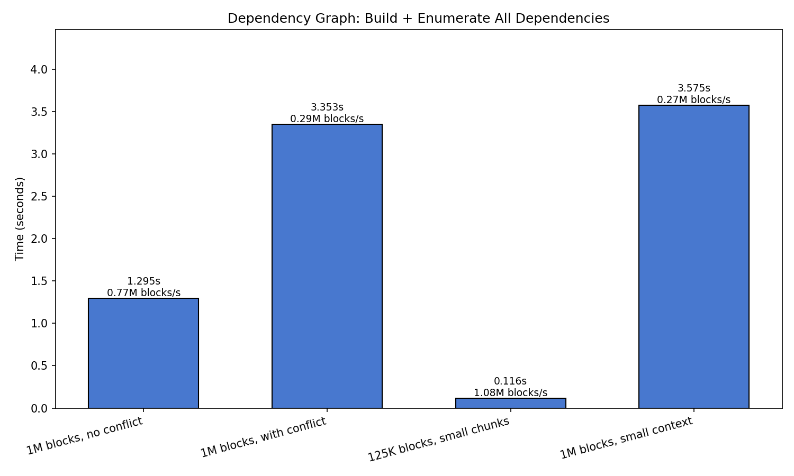

# Speed: 1.x versus 2.0

Three measurements, each from a script in this directory that runs on
either line. Numbers below are from daisy 1.2.3 (master) and daisy 2.0.0
on one 96-core machine; the CSV files next to the scripts hold the raw
rows and `plots.py` draws the figures from them.

```
python experiments/speed/throughput_by_mode.py --csv throughput.csv   # run once per interpreter
python experiments/speed/scheduler_drain.py >> scheduler.csv          # run once per interpreter
python experiments/different_by_design/resume_check_function_vs_tracking/run.py   # the resume numbers
python experiments/speed/plots.py
python experiments/speed/dependency_graph_scaling.py                  # dep_graph_results.json, dep_graph.png
```

## Throughput by worker mode and worker count

10,000 no-op blocks (1-D, no conflicts). 2.0 is 17 to 330 times faster
at every worker count and in every mode. 1.x is bounded at about 23
blocks per second per worker, a 43 ms round trip per block that scales
linearly with workers (its tornado sockets leave Nagle on and run into
the 40 ms delayed-ACK timer); 2.0 sets `TCP_NODELAY` and is bounded by
its scheduler thread instead, peaking at 16 workers for a run this short.


| Mode | Workers | 1.x blocks/s | 2.0 blocks/s | Ratio |
| --- | --- | --- | --- | --- |
| A block function | 1 | 24 | 7,999 | 333 |
| A | 4 | 95 | 24,093 | 254 |
| A | 16 | 377 | 49,897 | 132 |
| A | 64 | 1,169 | 25,586 | 22 |
| B worker function | 1 | 23 | 7,547 | 328 |
| B | 4 | 94 | 26,235 | 279 |
| B | 16 | 377 | 46,821 | 124 |
| B | 64 | 1,177 | 26,192 | 22 |
| C external worker | 1 | 23 | 7,511 | 327 |
| C | 4 | 93 | 20,480 | 220 |
| C | 16 | 375 | 34,895 | 93 |
| C | 64 | 1,228 | 20,664 | 17 |

The three modes cost the same on each line: the mode only changes who
starts the worker process, not how blocks are handed out.

## Scheduler cost without workers

One thread acquiring and releasing every block from the `Scheduler`
object: no TCP, no processes, no `check_function`. This is the ceiling
either line could reach with infinitely fast workers. With read/write
conflicts the 1.x scheduler rebuilds every neighbouring block object on
each release, which is why its 3-D conflict grids are slow even with many
workers.


| Grid | 1.x blocks/s | 2.0 blocks/s |
| --- | --- | --- |
| 1-D, 100,000 blocks, no conflicts | 24,626 | 613,371 |
| 3-D, 8,000 blocks with context (conflicts) | 747 | 66,297 |

## Resume cost: check_function versus the built-in tracking store

20,000 blocks already done. With a `check_function` both lines call it
once per block on the scheduling thread before any worker gets work;
the built-in store on 2.0 reads one byte per block instead and needs no
`check_function`. Runtime is dominated by the per-block cost of the check
(a `stat` here), so the gap grows with slower checks and larger block
counts: in the evaluation's 100,000-block run the figures were 4.7 s for
1.x marker files, 1.0 s for 2.0 marker files and 0.3 s for the store.


| Strategy | Line | Resume, 20,000 blocks |
| --- | --- | --- |
| `check_function` that stats a marker file per block | 1.x | 1.05 s |
| same | 2.0 | 0.19 s |
| built-in tracking store (`Task(tracking_path=...)`) | 2.0 | 0.12 s |

The store also records per-block failure counts and, with
`resource_tracking=True`, per-block wall, CPU and memory figures at about
10 µs per block.

## Dependency graph construction and enumeration

How the cost of building a task's block graph and enumerating every block
with its upstream dependencies grows with block count, conflicts and
context, on 2.0 only. Construction is lazy, so all the cost is in the
enumeration; this is what decides whether a chunking is viable before any
worker starts.



| Grid | Blocks | Levels | Enumerate | Blocks/s |
| --- | --- | --- | --- | --- |
| 1000³ in 10³ blocks, no conflicts | 1,000,000 | 1 | 1.30 s | 772,149 |
| 1000³ in 10³ blocks, context 2, conflicts | 970,299 | 8 | 3.35 s | 289,397 |
| 200³ in 4³ blocks, no conflicts | 125,000 | 1 | 0.12 s | 1,079,035 |
| 500³ in 5³ blocks, context 1, conflicts | 970,299 | 8 | 3.58 s | 271,385 |
